  
  
  
  
  

I'm a Cognitive Science (Machine Learning and Neural Computation) and Applied Mathematics student at UC San Diego. I'm interested in machine learning and computational neuroscience, especially spiking neural networks and EEG, and in building AI products at hackathons. Check out my interactive portfolio at **[alexwoods1.github.io](https://alexwoods1.github.io/)**.

## Experience

- **Data Annotator – Software Engineering**, DataAnnotation.tech · Jun 2026–Present — RLHF feedback on language-model responses, and bug fixes in open-source libraries
- **AI Brain Science Programmer**, UC San Diego · May–Jun 2026 — Extended NEMAR EEG datasets through a text-based workflow
- **Undergraduate Research Assistant**, UC San Diego · Dec 2023–Dec 2025 — MATLAB and EEGLAB pipeline for patient EEG, including depression measures for 100+ patients
- **Instructional Assistant**, UC San Diego · Sep–Dec 2024 — Intro Python lab for 60+ students a week

## Achievements

- **1st Place** · AIC Hack for Humanity @ UC San Diego (Nov 2026) · [Headcount](https://headcount-demo.vercel.app/) · Calls every older adult in an evacuation zone, in their language, until everyone is accounted for

## Featured projects

- **[Headcount](https://headcount-demo.vercel.app/)** · Calls every older adult in an evacuation zone, in their language, until everyone is accounted for
- **[Spoken](https://github.com/AlexWoods1/QLearningHackathon)** · [demo](https://qlearninghackathon.vercel.app/) · Voice language tutor with Q-learning rewards (Gemini + Whisper)
- **[Conceiva](https://github.com/AlexWoods1/Conceiva)** · [demo](https://conceiva.vercel.app) · 48-hour hackathon telehealth platform for donor matching (FastAPI, AWS, Vercel, Gemini)
- **[Spiking Neural Network](https://github.com/AlexWoods1/Spiking-Neural-Network)** · Biologically inspired network of LIF neurons trained with surrogate gradients (NumPy, JAX)
- **[SuperSmallModel](https://github.com/AlexWoods1/SuperSmallModel)** · ~1M-parameter GPT from scratch in PyTorch
- **[EEG Lie Detection](https://github.com/AlexWoods1/Cogs_189_Project)** · Group project: real-time EEG GUI and an 8-channel classifier at 75% accuracy
- **[EMG Flappy Bird](https://github.com/AlexWoods1/EMGflappybird)** · EMG-controlled Flappy Bird (UCSD BENG 152)
- **[TritonDefense](https://github.com/AlexWoods1/TritonDefense)** · C++ mobile CCTV robot with live video and YOLO person detection
- **[Wingman](https://github.com/draande/DS3-Hacktoberfest-Project)** · Smart-glasses presentation coach (DS3 Hacktoberfest)

## Skills

**Languages**

**Tools**

**Libraries**

**AI**

## Stats

  
  

<!--
  These two cards are generated by a GitHub Action (.github/workflows/readme-stats.yml)
  every day at midnight UTC and committed as static SVGs in profile/.
  Colors are baked in at generation time: title, icons, and rank ring are #FFCD00 (gold),
  background is #182B49 (UC San Diego navy), and text is white. Because the files
  live in this repo, the profile does not call the stats API on each page view.

  profile/stats.svg and profile/top-langs.svg are already in the repo, so this
  section is not blank before the first run. After you merge, run the workflow
  once from the Actions tab (Update README cards → Run workflow) so the default
  GITHUB_TOKEN can refresh them. It also runs daily, and again when this
  workflow file changes on main.

  To change the navy or gold later, edit the color values in the workflow and rerun it.
-->

  
  
  
  

